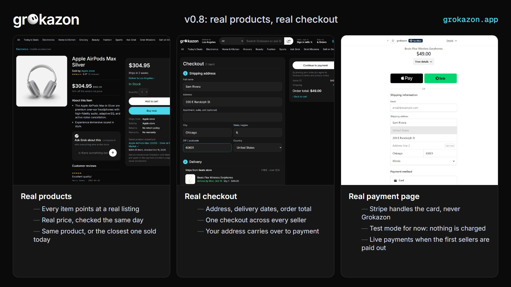
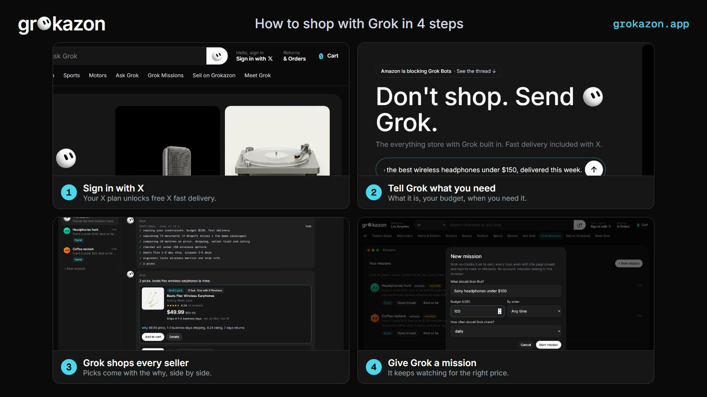
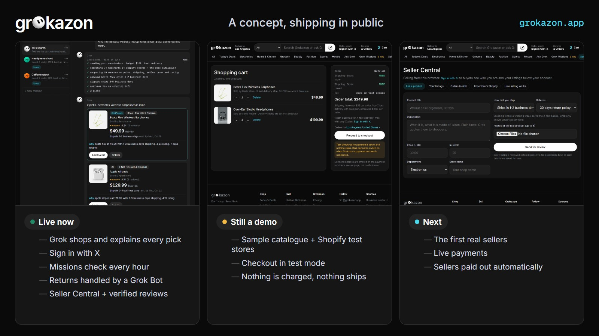

# Grokshop

The open-source Amazon-style store with Grok built in. One cart across every seller, one checkout, missions that keep
shopping while you're away, and an AI shopping agent that reads real product data and explains every pick.

Grokshop powers **[grokazon.app](https://grokazon.app)**, the reference deployment ([@AdeliaCmartins](https://x.com/AdeliaCmartins)).



## What it does

- **Ask Grok to shop.** Type what you need, your budget and when. The code filters the catalogue first, then one model
  call (xAI Grok, with Claude as backup) picks up to three products and says why, using only fields the catalogue has.
- **An Amazon-style store.** Departments, deals, search with filters, product pages with a buy box, one cart across
  every seller, a checkout page (address, delivery dates per seller, order total), orders, returns handled by a bot,
  verified-purchase reviews.
- **Real products.** Every sample product carries a checked link to a real listing and that listing's price
  (`api/data/refs.json`). Sellers list directly (reviewed in an admin page) or connect a Shopify store through the
  public Storefront API. A US-warehouse shelf (CJ Dropshipping) and an eBay connector are included behind switches.
- **Payments.** Stripe Checkout: the card is typed on Stripe's page, never on the store. Test mode by default; a live
  key is refused unless `STRIPE_LIVE=1` is set on purpose. Sellers are paid out through Stripe Connect.
- **Accounts.** Sign in with X (OAuth 2.0 PKCE; any X plan unlocks free "X fast" delivery) or with a Solana wallet
  (one signed message, no transaction). Orders, missions and reviews follow the account to every device.
- **Missions.** "Sony headphones under $100": an hourly Cloudflare cron keeps checking and reports back.



## How it is built

No build step. The site is static HTML, CSS and vanilla JavaScript (`*.html`, `app.js`, `store.js`, `common.js`).
The helper is one Cloudflare Worker (`api/`) with a KV namespace: the catalogue merge, the model call, orders,
sessions, payouts, the hourly cron. Nothing else to run.

```
index.html, search.html, product.html, cart.html, checkout.html, order.html, orders.html   the store
seller.html, admin.html, sell.html                                                         sellers + the owner's review queue
results.html, missions.html, about.html                                                    Ask Grok, missions, the agent page
api/src/index.js        routes, catalogue merge, the model call
api/src/store.js        cart quote, Stripe Checkout, orders, returns, listings, reviews, review queue
api/src/xauth.js        Sign in with X        api/src/wallet.js   Sign in with a wallet
api/src/shopify.js      Shopify Storefront    api/src/cj.js       US-warehouse shelf (CJ)    api/src/ebay.js  eBay Browse
api/src/missions.js     missions + cron       api/src/payouts.js  Stripe Connect payouts
api/data/refs.json      real-listing reference for every sample product
```

## Run it locally

1. Serve the site folder on port 5445, for example `python -m http.server 5445` from the repo root.
2. In `api/`, create `.dev.vars` (never committed) with the keys you have:
   ```
   ANTHROPIC_API_KEY=...      # or XAI_API_KEY=... for Grok (Grok is tried first when both are set)
   ADMIN_TOKEN=...            # password for admin.html
   X_CLIENT_SECRET=...        # Sign in with X (set X_CLIENT_ID in wrangler.toml)
   STRIPE_SECRET_KEY=sk_test_...
   CJ_API_KEY=...             # optional, with CJ_ON="1"
   ```
3. `npx wrangler dev --port 8806` in `api/`. On localhost the site talks to `127.0.0.1:8806` (`config.js`).
4. Open http://localhost:5445. `results.html?q=...&fixture=1` answers from a saved fixture, no model spend.

## Deploy

- Worker: `npx wrangler deploy` in `api/` (create a KV namespace and put its id in `wrangler.toml`; add secrets with
  `npx wrangler secret put NAME`).
- Site: `python deploy/build_zip.py` writes a Netlify-ready zip. `_redirects` passes `/api/*` to your Worker so the
  Worker's address never shows in the browser; put your own `*.workers.dev` address there.

## Tests and QA

- `node api/test/wallet.test.mjs`, `node api/test/cj.test.mjs`, `node api/test/ebay.test.mjs`: offline, against the
  providers' documented response shapes.
- `node qa/shots.cjs`: 173 headless checks of the whole store at 430x932 and 1280x800 (`npm i playwright` first, and
  run the local site + helper above).



## License

MIT. See `LICENSE`.
